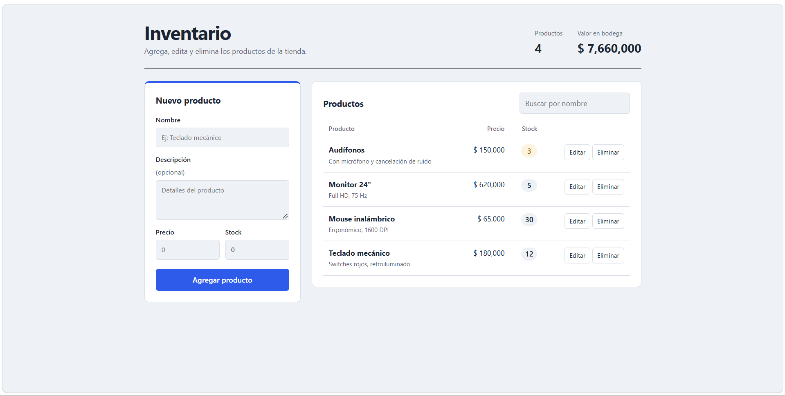

<div align="center">

# 📦 Inventario de Productos

**Aplicación web para administrar un inventario de productos**

CRUD completo con Angular, una API REST en Express y base de datos PostgreSQL.


</div>

---

## 📋 Sobre el proyecto

Sistema para llevar el control de un inventario de productos desde una interfaz web. El proyecto está dividido en tres capas: un **frontend** en Angular, una **API REST** en Express que contiene la lógica del servidor, y una base de datos **PostgreSQL** donde se guarda la información.

## ✨ Características

- ➕ Registro de nuevos productos
- 📋 Listado y consulta de productos
- ✏️ Edición de la información de un producto
- 🗑️ Eliminación de productos
- 🔌 Comunicación entre frontend y backend mediante API REST
- 🗄️ Persistencia de datos en PostgreSQL

## 🖼️ Vista previa



## 🛠️ Tecnologías

| Capa | Tecnología | Uso |
|------|------------|-----|
| Frontend | Angular 18 + TypeScript | Interfaz de usuario y navegación |
| Backend | Node.js + Express  | API REST y lógica de negocio |
| Backend | `pg` | Conexión con PostgreSQL |
| Backend | `dotenv` y `cors` | Variables de entorno y acceso desde el frontend |
| Base de datos | PostgreSQL | Almacenamiento de los productos |
| Control de versiones | Git y GitHub | Código fuente del proyecto |

## 📁 Estructura del proyecto

```
Inventario-de-productos/
│
├── backend/          # API REST (Express)
│   └── src/
│       └── index.js  # Punto de entrada del servidor
├── frontend/         # Aplicación Angular
│   └── src/
├── img/              # Capturas de pantalla
│
├── .gitignore
└── README.md
```

## 🚀 Cómo ejecutarlo

### Requisitos previos

- [Node.js](https://nodejs.org/) (versión LTS)
- [PostgreSQL](https://www.postgresql.org/download/) instalado y en ejecución
- [Git](https://git-scm.com/)

### 1. Clonar el repositorio

```bash
git clone https://github.com/nickjeferson019/Inventario-de-productos.git
cd Inventario-de-productos
```

### 2. Base de datos

1. Crea una base de datos nueva en PostgreSQL (con pgAdmin o con `psql`).
2. Crea la tabla de productos que usa la API.

### 3. Backend

```bash
cd backend
npm install
```

Crea un archivo llamado `.env` dentro de la carpeta `backend` con los datos de tu base de datos:

```
PORT=3000
DB_HOST=localhost
DB_PORT=5432
DB_USER=tu_usuario
DB_PASSWORD=tu_contraseña
DB_NAME=nombre_de_tu_base_de_datos
```

Inicia el servidor:

```bash
npm start
```

### 4. Frontend

En otra terminal:

```bash
cd frontend
npm install
npm start
```

Luego abre [http://localhost:4200](http://localhost:4200) en tu navegador. El backend debe estar en ejecución para que la aplicación cargue los productos.

## 👤 Autor

**Nick Jeferson Rivera Garces**

[](https://github.com/nickjeferson019)
